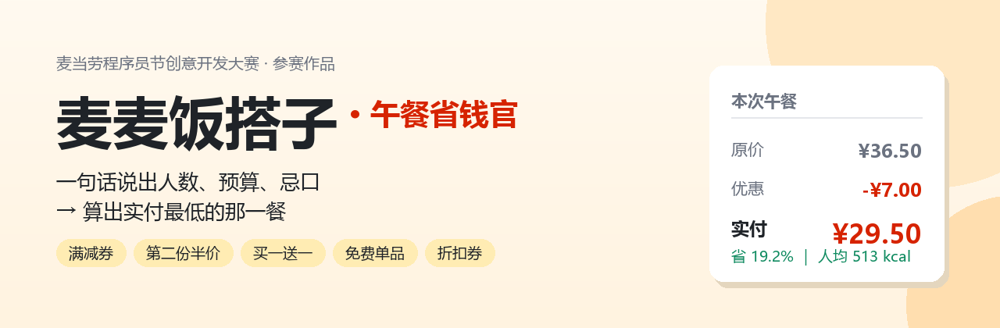
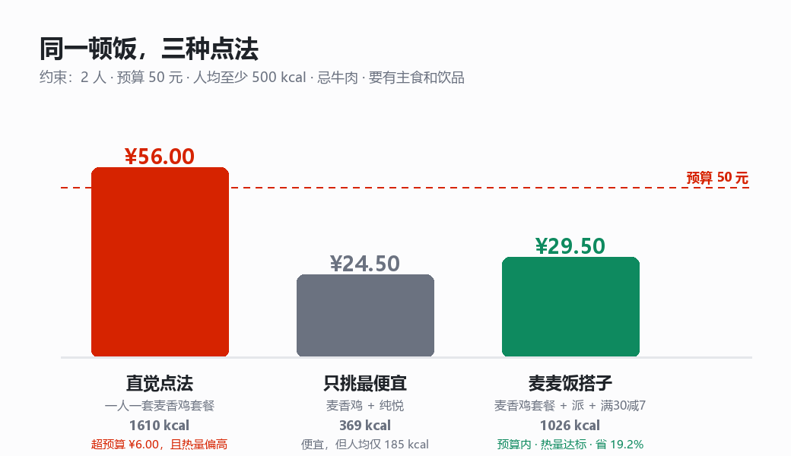
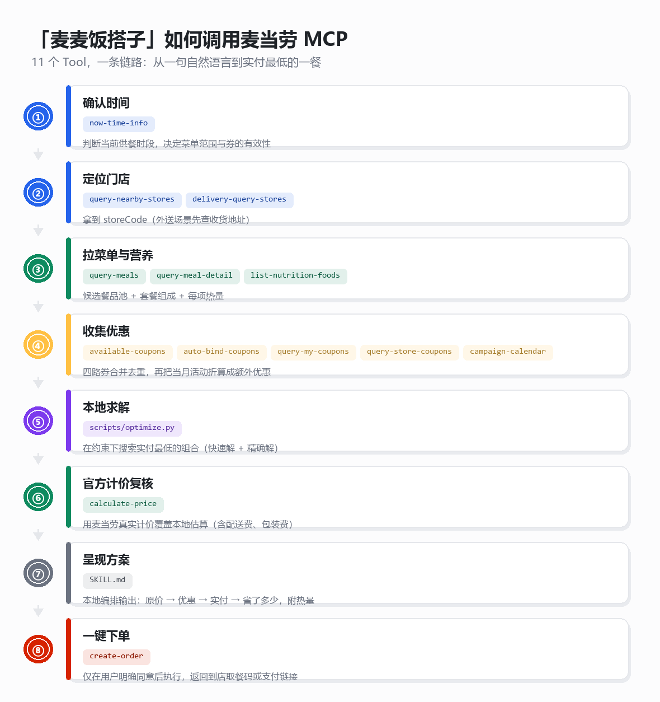
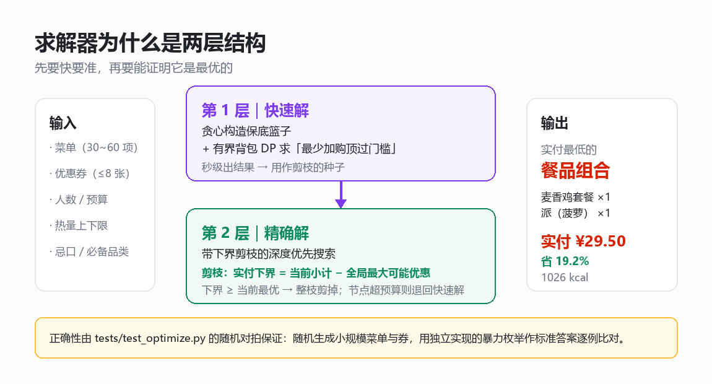

<div align="center">



**麦当劳程序员节创意开发大赛参赛作品 · 基于麦当劳 MCP 构建**

</div>

---

## 为什么需要它

中午 12 点，你只有 40 分钟和 40 块钱。

打开麦当劳小程序，菜单几十项，券包七八张：满 30 减 7、满 45 减 12、指定商品第二份半价、
买一送一、免费单品…… 你隐约觉得"好像凑个门槛更划算"，但到底凑哪几样、凑完人均多少卡路里、
最后实付多少钱，没人算得清。于是大多数人的选择是：随便点一个套餐，然后继续饿着或者继续胖着。

**「麦麦饭搭子」把这件纠结事变成一个可以求解的优化问题：**

> 给定门店菜单、可用的券、人数 / 预算 / 热量 / 忌口等约束，
> 找出**实付金额最低**的那一篮餐品。

它不是在"推荐套餐"，而是在**解一道带约束的组合优化题**——包括帮你判断
"为了用这张券多买两样，到底值不值"。

## 目标用户

- **学生党**：预算敏感，愿意为了省 8 块钱多想一秒。
- **上班族**：午休时间短，希望点餐决策一次到位，不想在券包里翻来覆去。

## 真实效果示例

下面这组结果用的是**麦当劳 MCP 返回的真实数据**
（门店：麦当劳上海吴江路餐厅，`query-meals` 的现价 + `list-nutrition-foods` 的官方热量，
完整数据见 [`examples/mcd-real-menu-2026-10-11.json`](examples/mcd-real-menu-2026-10-11.json)）。

约束：2 人 · 总预算 50 元 · 人均至少 500 kcal · 忌牛肉 · 必须有主食和饮品。

```bash
python scripts/optimize.py --input examples/mcd-real-menu-2026-10-11.json
```

```
  · 麦香鸡套餐 ×1   ¥  28.00     805 kcal
  · 派（菠萝） ×1   ¥   8.50     221 kcal
  ------------------------------------------
  小计  ¥36.50  →  优惠券 -¥7.00（满 30 减 7）
  实付  ¥29.50   省 19.2%
  总热量  1026 kcal   人均 513 kcal
  求解方式  精确最优
```

同样的约束下，三种点法的差距：



关键在于：**最优点法不是"挑最便宜的"，也不是"凑到门槛之上一点"，
而是"换一个组合恰好卡在门槛上"**。这类反直觉的解只有算法能稳定找出来。

## 它是怎么跑起来的

基于麦当劳 MCP 的 11 个 Tool，一条链路从一句自然语言走到下单：



详细的工具清单、参数映射与调用时序见 [`MCP_INTEGRATION.md`](MCP_INTEGRATION.md)。

## 算法说明

算法内核在 `scripts/optimize.py`，分两层：



1. **快速解** —— 贪心构造保底篮子，再用同一个有界背包 DP 分别解决
   "花最少的钱顶过满减门槛"和"花最少的钱补足热量缺口"两个子问题。秒级出结果。
2. **精确解** —— 以快速解为下界种子，做带剪枝的深度优先搜索。剪枝依据：
   任一分支的实付下界 = 当前小计 − 全局最大可能优惠；下界不低于当前最优解即整枝剪掉。

实测在 27 项真实菜单、6 张券的规模下约 5 秒求出全局最优；
菜单更大或搜索触顶时自动退回快速解并在结果中注明。

**正确性是被验证过的，不是拍脑袋：**

```bash
python tests/test_optimize.py
```

14 个用例里包含一组**随机对拍**：随机生成小规模菜单与券，
用一份独立实现的暴力枚举作为标准答案，逐例比对精确解的实付金额，
确保剪枝不会漏掉更优解。开发过程中正是这组对拍揪出过两个真实 bug
（指定商品券丢解、补热量时贪心把自己顶出预算）。

## 安装与使用

### 1. 申请麦当劳 MCP Token

按 [麦当劳 MCP Server 使用指南](https://github.com/M-China/mcd-mcp-server) 的说明，
用手机号登录 [open.mcd.cn/mcp](https://open.mcd.cn/mcp) 后申请 MCP Token。

### 2. 在 WorkBuddy 中配置 MCP

左侧边栏【专家·技能·连接器】→【连接器】→ 右上角【自定义连接器】→【配置 MCP】，
填入：

```json
{
  "mcpServers": {
    "mcd-mcp": {
      "type": "streamablehttp",
      "url": "https://mcp.mcd.cn",
      "headers": {
        "Authorization": "Bearer ${MCD_MCP_TOKEN}"
      }
    }
  }
}
```

把 `${MCD_MCP_TOKEN}` 换成你自己的 Token（或用环境变量注入），保存后回到【自定义连接器】把 `mcd-mcp` 启用。

> ⚠️ **不要把真实 Token 写进任何提交到仓库的文件。** 本仓库所有示例配置都使用
> `${MCD_MCP_TOKEN}` 环境变量占位符，符合参赛声明的信息安全要求。

### 3. 载入本 Skill

把本目录（`SKILL.md` 在根目录）放入 WorkBuddy 的 Skill 目录：

- 用户级：`~/.workbuddy/skills/mcmeal-budget-mate/`
- 或项目级：`<项目>/.workbuddy/skills/mcmeal-budget-mate/`

然后在对话里直接说需求即可：

> 帮我用麦当劳点个午饭，两个人，一共不超过 50 块，不吃牛肉，要吃得饱一点。

### 4. 单独跑算法引擎（可选）

算法内核不依赖 MCP、不联网，可以离线跑：

```bash
python scripts/optimize.py --input examples/mcd-real-menu-2026-10-11.json
python scripts/optimize.py --input examples/mcd-real-menu-2026-10-11.json --json   # 机器可读
python scripts/optimize.py --input examples/mcd-real-menu-2026-10-11.json --fast   # 只跑快速解
```

## 输入 JSON 结构

```json
{
  "constraints": {
    "people": 2,
    "budget": 50,
    "min_calories_per_person": 500,
    "max_calories_per_person": 1000,
    "must_include_tags": ["主食", "饮品"],
    "exclude_tags": ["含牛肉"],
    "max_items": 8,
    "qty_cap": 2
  },
  "menu": [
    {"code": "1406", "name": "板烧鸡腿堡", "price": 23.5, "calories": 391, "tags": ["主食"]}
  ],
  "coupons": [
    {"id": "CP-01", "name": "满30减7", "kind": "threshold", "threshold": 30, "discount": 7},
    {"id": "CP-02", "name": "免费脆薯饼", "kind": "free_item", "target_code": "521741"},
    {"id": "CP-03", "name": "麦辣鸡翅买一送一", "kind": "bogo", "target_code": "1700"}
  ]
}
```

支持的券类型（按麦当劳真实券型整理）：

| kind | 含义 | 例子 |
|---|---|---|
| `threshold` | 满 X 减 Y | 满 30 减 7 |
| `fixed` | 直接立减 | 小食立减 5 |
| `percent` | 打折，可封顶 | 全场 9 折最高减 6 |
| `second_half` | 指定商品第二份半价 | 板烧第二份半价 |
| `bogo` | 指定商品买一送一 | 麦旋风买一送一 |
| `free_item` | 免费送一份指定商品 | 免费脆薯饼 |

后三种是接入真实 MCP 数据时补上的——麦当劳的券远不止"满减"一种，
只支持满减的话，券包里一半的券都用不上。

## 目录结构

```
mcmeal-budget-mate/
├── SKILL.md                          # WorkBuddy Skill 主入口（工作流程编排）
├── README.md                         # 本文件
├── MCP_INTEGRATION.md                # 麦当劳 MCP 接入说明、工具清单与调用流程
├── CONTEST_DECLARATION.md            # 参赛声明（官方原文，未做任何改动）
├── workbuddy.md                      # 使用 WorkBuddy 开发本项目的对话上下文
├── scripts/
│   ├── optimize.py                   # 凑单最优解引擎（核心算法）
│   └── make_images.py                # 本仓库全部配图的生成脚本
├── tests/
│   └── test_optimize.py              # 14 个用例，含随机对拍
├── examples/
│   ├── lunch_for_two.json            # 自包含的合成示例（离线可跑）
│   └── mcd-real-menu-2026-10-11.json # 真实门店菜单 + 官方营养数据（可复现）
├── images/                           # 由 scripts/make_images.py 生成的配图
└── mcp-config.example.json           # MCP 配置示例（仅环境变量占位符 ${MCD_MCP_TOKEN}）
```

## 免责声明

本项目为麦当劳程序员节创意开发大赛参赛作品，由参赛者独立开发，非麦当劳官方产品。
项目输出仅供参考，不构成医疗、营养或其他专业建议；餐品信息、价格及供应状态以
麦当劳官方渠道的实时结果为准。完整声明见 [CONTEST_DECLARATION.md](CONTEST_DECLARATION.md)。
